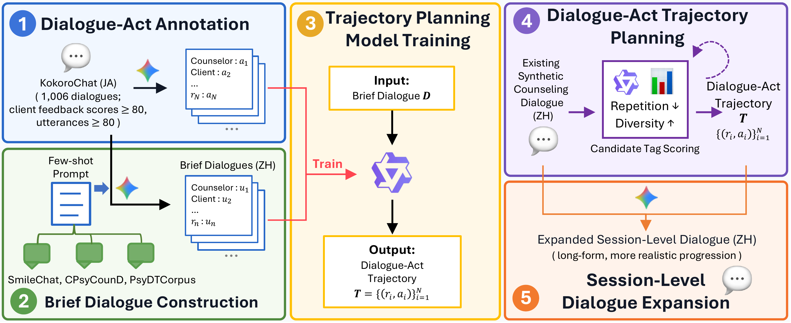

<a id="counseltraj"></a>

# CounselTraj: Synthesizing Process-Aware Psychological Counseling Dialogues via Dialogue-Act Trajectory Planning

🎉 **Accepted to the EACL 2027 Main Conference.**

📄 **Paper:** arXiv link coming soon.
<!-- Replace the line above with the arXiv paper link when available. -->

We introduce three resources for psychological counseling dialogue synthesis
and response generation:

- **[CounselTraj](https://huggingface.co/UEC-InabaLab/CounselTraj):** a trajectory
  planning model that maps brief counseling dialogues to long, session-level
  dialogue-act (DA) trajectories, which guide dialogue expansion.
- **[CounselTrajD](#counseltrajd):** a dataset of **10,964** synthetic Chinese
  counseling dialogues, averaging **87.45 utterances per dialogue** (individual
  client or counselor messages).
- **[CounselTrajLM](https://huggingface.co/UEC-InabaLab/CounselTrajLM):** a counseling
  dialogue model fine-tuned on CounselTrajD to generate the next counselor response
  from dialogue history.

<a id="data-construction"></a>

## 🧩 Data construction

CounselTraj learns session-level interaction patterns from
[KokoroChat](https://github.com/UEC-InabaLab/KokoroChat), a Japanese counseling
dialogue dataset collected through role-playing by trained counselors
([Qi et al., ACL 2025](https://aclanthology.org/2025.acl-long.608/)), and uses them
to expand brief Chinese synthetic counseling dialogues.



1. **Annotate dialogue acts.** Label the client and counselor utterances in
   selected KokoroChat sessions to obtain complete dialogue-act trajectories.
2. **Construct brief dialogues.** Rewrite the Japanese sessions into brief Chinese
   dialogues, pairing each brief dialogue with its original annotated trajectory.
3. **Train the trajectory planner.** Fine-tune Qwen3-8B on these pairs to predict
   session-level dialogue-act trajectories from brief dialogues.
4. **Plan trajectories for new inputs.** Apply the planner to brief dialogues from
   SmileChat, CPsyCounD, and PsyDTCorpus, conditioning each trajectory on its input.
5. **Expand into session-level dialogues.** Use the brief dialogue and planned
   trajectory to guide long-form generation. For CounselTrajD, GPT-5.5 produces
   the resulting collection of 10,964 Chinese counseling dialogues.

<a id="dialogue-acts"></a>

### 💬 Dialogue acts and trajectories

A **dialogue act (DA)** describes the communicative function of an utterance,
such as asking an open question, sharing an inner feeling, or acknowledging the
other speaker. CounselTraj uses separate inventories for **clients (14 tags)**
and **counselors (11 tags)**.

A **dialogue-act trajectory** is an ordered sequence of speaker–tag pairs across
a session. For example, a short illustrative segment could be
`counselor: OpenQuestion → client: SelfDisclosure → counselor: Reflection → client: SimpleAnswer`.
The planner predicts this sequence from a brief dialogue, and the expansion model
uses it to guide what each utterance does and how the interaction develops.

<details>
<summary>Client dialogue acts (14 tags)</summary>

| Tag | Meaning |
| --- | --- |
| `DetailedDescription` | Describing facts, events, background, or context in detail. |
| `UnderstandingCheck` | Checking the meaning of what the counselor has said. |
| `SimpleAnswer` | Giving a short factual answer without elaboration. |
| `Agreement` | Accepting or agreeing with the counselor's view, interpretation, or empathy. |
| `Request` | Asking for advice, solutions, or concrete guidance. |
| `SelfDisclosure` | Sharing inner feelings, vulnerability, core values, or self-critical thoughts. |
| `PositiveEmotion` | Expressing relief, hope, or another positive emotional change. |
| `Backchannel` | Giving a minimal response to show listening. |
| `Question` | Asking a general question, apart from advice requests or understanding checks. |
| `Hesitation` | Expressing uncertainty, hesitation, silence, or difficulty responding. |
| `Resistance` | Rejecting or showing reluctance toward the counselor's advice, interpretation, or intervention. |
| `Greeting` | Opening or closing the conversation. |
| `Thanking` | Expressing simple thanks. |
| `Other` | Other functions, such as checking the connection or indicating a temporary absence. |

</details>

<details>
<summary>Counselor dialogue acts (11 tags)</summary>

| Tag | Meaning |
| --- | --- |
| `OpenQuestion` | Asking a question that invites a free, broad response. |
| `ClosedQuestion` | Asking a yes/no question or one with a restricted answer range. |
| `Paraphrase` | Restating the client's facts or content to organize and confirm understanding. |
| `Reflection` | Reflecting the client's underlying emotions or meanings to support exploration. |
| `Affirm` | Affirming the client's strengths, motivation, or abilities. |
| `Suggest` | Proposing an action, perspective, coping method, or possible solution. |
| `Inform` | Providing information, explanations, resources, or answers. |
| `Backchannel` | Giving a brief response to show listening. |
| `Greeting` | Opening or closing the conversation. |
| `Thanking` | Expressing gratitude. |
| `Other` | Session management, apologies, or other functions outside these categories. |

</details>

In the released JSONL files, `user` denotes the client and `assistant` denotes the
counselor. The `dialogue_act` field in each `messages` entry preserves the tag
emitted during generation; `planned_dialogue_acts` stores the intended trajectory.
These tags are not guaranteed to align one-to-one with the planned trajectory;
see the
[data schema](data/README.md#schema).

<a id="models"></a>

## 🤗 Models

| Model | Purpose | Base model | Format |
| --- | --- | --- | --- |
| [CounselTraj](https://huggingface.co/UEC-InabaLab/CounselTraj) | Dialogue-act trajectory planning for dialogue synthesis | Qwen3-8B | LoRA adapter |
| [CounselTrajLM](https://huggingface.co/UEC-InabaLab/CounselTrajLM) | Next counselor response generation from dialogue history | Qwen3.5-9B | LoRA adapter |

🔒 Both model repositories are currently private and require access through an
authorized Hugging Face account. Each repository includes its tokenizer, model
card, and inference script.

<a id="counseltrajd"></a>

## 🗂️ CounselTrajD

CounselTrajD contains **10,964 synthetic Chinese counseling dialogues**.
The complete release contains **958,791 utterances** across 15 topic categories.
These are generated expansions conditioned on source conversations, not newly
collected human counseling sessions.

| Source of seed conversations | Dialogues | Data terms | Paper |
| --- | ---: | --- | --- |
| SmileChat | 7,672 | CC0-1.0; see source notices | [SMILE (Qiu et al., 2024)](https://aclanthology.org/2024.findings-emnlp.34/) |
| PsyDTCorpus | 2,595 | Apache-2.0; retain applicable notices | [PsyDT (Xie et al., 2025)](https://aclanthology.org/2025.acl-long.55/) |
| CPsyCounD | 697 | CC-BY-SA-4.0; see source notices | [CPsyCoun (Zhang et al., 2024)](https://aclanthology.org/2024.findings-acl.830/) |
| **Total** | **10,964** | **Source-specific terms, not a single blanket license** | |

The three losslessly compressed JSONL files together form one dataset. They are
separated by provenance to make attribution and licensing explicit. Raw seed
conversation text, provider API envelopes, billing information, and internal file
paths are not included.

<a id="dataset-statistics"></a>

### 📊 Dataset statistics

| Statistic | Overall | Client | Counselor |
| --- | ---: | ---: | ---: |
| Dialogues | 10,964 | — | — |
| Utterances | 958,791 | 473,910 | 484,881 |
| Mean utterances / dialogue | 87.45 | 43.22 | 44.22 |
| Characters | 42,197,155 | 18,321,830 | 23,875,325 |
| Mean characters / dialogue | 3,848.70 | 1,671.09 | 2,177.61 |
| Mean characters / utterance | 44.04 | 38.68 | 49.29 |
| Topics | 15 | — | — |

Utterances are individual messages. Character counts exclude speaker labels and
dialogue-act tags. Mean characters per utterance is averaged across dialogues.
Counts were verified against the released data and [manifest](data/manifest.json).

<details>
<summary>Topic distribution (15 topics)</summary>

| Topic | Dialogues | Share |
| --- | ---: | ---: |
| Romantic relationships | 1,037 | 9.46% |
| Growth / planning | 1,010 | 9.21% |
| Interpersonal relationships | 1,010 | 9.21% |
| Work / career | 1,010 | 9.21% |
| Self-identity | 1,009 | 9.20% |
| Family / parenting | 1,004 | 9.16% |
| Emotion / anxiety | 970 | 8.85% |
| Depression / low mood | 930 | 8.48% |
| Academic / school | 838 | 7.64% |
| Behavior / habits | 711 | 6.48% |
| Health / sleep / somatic concerns | 623 | 5.68% |
| Therapy / psychology knowledge | 399 | 3.64% |
| Other | 219 | 2.00% |
| Sexuality | 97 | 0.88% |
| Social adaptation | 97 | 0.88% |

</details>

<a id="download-and-verify"></a>

### 📦 Download and verify

After obtaining this repository, run with Python 3.8 or newer:

```bash
python3 scripts/load_counseltraj.py
python3 -m unittest discover -s tests -v
```

The loader verifies file checksums, unique IDs, record counts, and utterance counts.
It uses only the Python standard library. For programmatic streaming:

```python
from scripts.load_counseltraj import load_dialogues

for dialogue in load_dialogues("data"):
    messages = dialogue["messages"]
```

See [the data card](data/README.md) for the schema and dataset details,
[source notices](THIRD_PARTY_NOTICES.md) for attribution, and
[licensing scope](LICENSING.md) for the code/data distinction.

<a id="evaluation-prompts"></a>

### 🔎 Evaluation prompts

The [evaluation prompts](evaluation/README.md) cover response-level
counseling skills on PsyDial-D101 and dialogue-level counseling processes on
PsychEval, corresponding to Appendix D.2 and Appendix D.4 of the paper.
The [research basis and references](evaluation/README.md#research-basis-and-references)
explain the prior work behind the evaluation data and criteria, with publication links.

<a id="limitations"></a>

### 🌿 Limitations

This dataset is not a substitute for professional diagnosis, treatment, or safety
evaluation. Synthetic generation and omission of seed fields do not establish
that every utterance is anonymous; automated pattern screening is only a limited
check.

<a id="citation"></a>

### 📚 Citation

If you use CounselTraj in your research, please cite:

```bibtex
@inproceedings{qi-inaba-2027-counseltraj,
    title = "{CounselTraj}: Synthesizing Process-Aware Psychological Counseling Dialogues via Dialogue-Act Trajectory Planning",
    author = "Qi, Zhiyang and Inaba, Michimasa",
    booktitle = "Proceedings of the 20th Conference of the European Chapter of the Association for Computational Linguistics",
    year = "2027",
}
```
