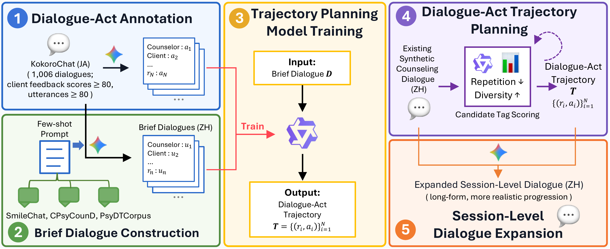

<a id="counseltraj"></a>

# CounselTraj：基于对话行为轨迹规划的过程感知心理咨询对话合成

[English](README.md) | **简体中文**

🎉 **论文已被 EACL 2027 主会接收。**

📄 **论文：** arXiv 链接即将公布。
<!-- 论文上线后，将上一行替换为 arXiv 链接。 -->

我们为心理咨询对话合成与回复生成构建了三项资源：

- **[CounselTraj](https://huggingface.co/UEC-InabaLab/CounselTraj)：** 将简短心理咨询对话映射为完整会话级长对话行为（Dialogue Act，DA）轨迹的规划模型，用于引导对话扩充。
- **[CounselTrajD](#counseltrajd)：** 包含 **10,964 段**合成中文心理咨询对话的数据集，平均每段包含 **87.45 次发言**，每次发言指来访者或咨询师的一条消息。
- **[CounselTrajLM](#counseltrajlm)：** 使用 CounselTrajD 微调的心理咨询对话模型，根据对话历史生成咨询师的下一次回复。

<a id="data-construction"></a>

## 🧩 数据构建流程

CounselTraj 从 [KokoroChat](https://github.com/UEC-InabaLab/KokoroChat) 中学习完整会话中的互动模式，并将其用于扩充简短的中文合成心理咨询对话。KokoroChat 是由经过培训的咨询师通过角色扮演收集的日语心理咨询对话数据集（[Qi 等，ACL 2025](https://aclanthology.org/2025.acl-long.608/)）。



1. **标注对话行为。** 对选定 KokoroChat 会话中来访者和咨询师的发言进行标注，得到完整的 DA 轨迹。[DA 标注提示词](annotation/README.md) 包括日文来访者版、日文咨询师版，以及用于跨数据集分析的中文和英文来访者版。
2. **构建简短对话。** 将日语会话改写为简短的中文对话，并与原始会话的标注轨迹配对。
3. **训练轨迹规划模型。** 使用这些配对数据微调 Qwen3-8B，使其根据简短对话预测完整会话级 DA 轨迹。
4. **为新输入规划轨迹。** 将规划模型应用于 SmileChat、CPsyCounD 和 PsyDTCorpus 的简短对话，根据各自输入生成轨迹。
5. **扩充为完整会话。** 使用简短对话与规划轨迹引导长对话生成。CounselTrajD 使用 GPT-5.5 生成，最终包含 10,964 段中文心理咨询对话。

<a id="dialogue-acts"></a>

### 💬 对话行为与轨迹

**对话行为（DA）** 描述一次发言在交流中的功能，例如提出开放式问题、表达内心感受或表示正在倾听。CounselTraj 分别为 **来访者（14 类标签）** 和 **咨询师（11 类标签）** 定义了标签集合。

**DA 轨迹**是贯穿整段会话、按顺序排列的“说话者—标签”序列。例如，一个简短的示意片段可以是：
`counselor: OpenQuestion → client: SelfDisclosure → counselor: Reflection → client: SimpleAnswer`。
规划模型根据简短对话预测这一序列，扩充模型则参考该序列，引导发言的功能与互动的发展。

<details>
<summary>来访者对话行为（14 类标签）</summary>

| 标签 | 含义 |
| --- | --- |
| `DetailedDescription` | 详细描述事实、事件、背景或情境。 |
| `UnderstandingCheck` | 确认或询问咨询师发言的含义。 |
| `SimpleAnswer` | 给出简短的事实性回答，不作展开。 |
| `Agreement` | 接受或认同咨询师的观点、解释或共情。 |
| `Request` | 请求建议、解决方案或具体指导。 |
| `SelfDisclosure` | 表达内心感受、脆弱性、核心价值观或自我批评的想法。 |
| `PositiveEmotion` | 表达放松、希望或其他积极情绪变化。 |
| `Backchannel` | 通过极简回应表示正在倾听。 |
| `Question` | 提出一般性问题，不包括请求建议或确认含义。 |
| `Hesitation` | 表现出不确定、犹豫、沉默或难以回应。 |
| `Resistance` | 对咨询师的建议、解释或干预表示拒绝、抵触或不情愿。 |
| `Greeting` | 开始或结束对话时的问候。 |
| `Thanking` | 简单表达感谢。 |
| `Other` | 其他功能，例如检查连接或表示暂时离开。 |

</details>

<details>
<summary>咨询师对话行为（11 类标签）</summary>

| 标签 | 含义 |
| --- | --- |
| `OpenQuestion` | 提出允许自由、广泛作答的开放式问题。 |
| `ClosedQuestion` | 提出是非问题或回答范围受限的问题。 |
| `Paraphrase` | 重述来访者表达的事实或内容，以整理信息并确认理解。 |
| `Reflection` | 回应来访者内在的情绪或含义，支持其进一步探索。 |
| `Affirm` | 肯定来访者的优势、动机或能力。 |
| `Suggest` | 提出行动、视角、应对方法或可能的解决方案。 |
| `Inform` | 提供信息、解释、资源或回答。 |
| `Backchannel` | 通过简短回应表示正在倾听。 |
| `Greeting` | 开始或结束对话时的问候。 |
| `Thanking` | 表达感谢。 |
| `Other` | 会话管理、道歉或其他未归入上述类别的功能。 |

</details>

发布的 JSONL 文件中，`user` 表示来访者，`assistant` 表示咨询师。`messages` 中的 `dialogue_act` 字段保留生成时输出的标签；`planned_dialogue_acts` 保存计划轨迹。**这些标签不保证与计划轨迹一一对应**，详见[数据结构说明](data/README.md#schema)。

<a id="models"></a>

## 🤗 模型

| 模型 | 用途 | 基座模型 | 格式 |
| --- | --- | --- | --- |
| [CounselTraj](https://huggingface.co/UEC-InabaLab/CounselTraj) | 为对话合成规划 DA 轨迹 | Qwen3-8B | LoRA 适配器 |

🔒 所列模型仓库目前为私有仓库，需要使用已获授权的 Hugging Face 账户访问。各仓库包含分词器、模型卡和推理脚本。

<a id="counseltrajlm"></a>

### CounselTrajLM

CounselTrajLM 系列模型使用 [CounselTrajD](#counseltrajd) 微调，根据对话历史生成咨询师的下一次回复。当前版本如下：

| 基座模型 | 格式 | 下载 |
| --- | --- | --- |
| Qwen3.5-9B | 已合并的 BF16 完整模型 | [Hugging Face](https://huggingface.co/UEC-InabaLab/CounselTrajLM) |
| Qwen2.5-7B-Instruct | 已合并的 BF16 完整模型 | [Hugging Face](https://huggingface.co/UEC-InabaLab/CounselTrajLM-Qwen2.5-7B) |
| Qwen3-8B | 已合并的 BF16 完整模型 | [Hugging Face](https://huggingface.co/UEC-InabaLab/CounselTrajLM-Qwen3-8B) |

<a id="counseltrajd"></a>

## 🗂️ CounselTrajD

CounselTrajD 包含 **10,964 段合成中文心理咨询对话**，共 **958,791 次发言**，涵盖 15 个主题类别。这些对话是基于种子对话生成的扩充结果，并非新收集的真人心理咨询会话。

| 种子对话来源 | 对话数 | 数据使用条款 | 论文 |
| --- | ---: | --- | --- |
| SmileChat | 7,672 | CC0-1.0；参见来源声明 | [SMILE（Qiu 等，2024）](https://aclanthology.org/2024.findings-emnlp.34/) |
| PsyDTCorpus | 2,595 | Apache-2.0；保留适用声明 | [PsyDT（Xie 等，2025）](https://aclanthology.org/2025.acl-long.55/) |
| CPsyCounD | 697 | CC-BY-SA-4.0；参见来源声明 | [CPsyCoun（Zhang 等，2024）](https://aclanthology.org/2024.findings-acl.830/) |
| **合计** | **10,964** | **按来源适用不同条款，不采用统一的数据许可** | |

三个无损压缩的 JSONL 文件共同构成一个数据集。按来源分别存储，便于明确署名与许可要求。发布内容不包含原始种子对话文本、API 服务商的响应封装、计费信息或内部文件路径。

<a id="dataset-statistics"></a>

### 📊 数据集统计

| 统计项 | 总体 | 来访者 | 咨询师 |
| --- | ---: | ---: | ---: |
| 对话数 | 10,964 | — | — |
| 发言数 | 958,791 | 473,910 | 484,881 |
| 平均每段对话的发言数 | 87.45 | 43.22 | 44.22 |
| 字符数 | 42,197,155 | 18,321,830 | 23,875,325 |
| 平均每段对话的字符数 | 3,848.70 | 1,671.09 | 2,177.61 |
| 平均每次发言的字符数 | 44.04 | 38.68 | 49.29 |
| 主题数 | 15 | — | — |

一次发言指一条消息。字符数不包含说话者标记和 DA 标签。“平均每次发言的字符数”先在每段对话内计算，再对各段对话取平均。统计已根据发布数据和[清单](data/manifest.json)核对。

<details>
<summary>主题分布（15 类）</summary>

| 主题 | 对话数 | 占比 |
| --- | ---: | ---: |
| 婚恋关系 | 1,037 | 9.46% |
| 成长规划 | 1,010 | 9.21% |
| 人际社交 | 1,010 | 9.21% |
| 职场职业 | 1,010 | 9.21% |
| 自我认同 | 1,009 | 9.20% |
| 家庭亲子 | 1,004 | 9.16% |
| 情绪焦虑 | 970 | 8.85% |
| 抑郁低落 | 930 | 8.48% |
| 学业校园 | 838 | 7.64% |
| 行为习惯 | 711 | 6.48% |
| 健康睡眠躯体 | 623 | 5.68% |
| 治疗与心理知识 | 399 | 3.64% |
| 其他 | 219 | 2.00% |
| 性心理 | 97 | 0.88% |
| 社会适应 | 97 | 0.88% |

</details>

<a id="download-and-verify"></a>

### 📦 下载与校验

获取本仓库后，使用 Python 3.8 或更高版本运行：

```bash
python3 scripts/load_counseltraj.py
python3 -m unittest discover -s tests -v
```

加载脚本会校验文件校验和、ID 唯一性、记录数及发言数，仅依赖 Python 标准库。也可在程序中流式读取：

```python
from scripts.load_counseltraj import load_dialogues

for dialogue in load_dialogues("data"):
    messages = dialogue["messages"]
```

数据结构与详细信息见[数据卡](data/README.md)，来源署名见[第三方数据声明](THIRD_PARTY_NOTICES.md)，代码与数据的许可区别见[许可范围](LICENSING.md)。

<a id="evaluation-prompts"></a>

### 🔎 评估提示词

[评估提示词](evaluation/README.md)涵盖基于 PsyDial-D101 的回复级咨询技能评估，以及基于 PsychEval 的对话级咨询过程评估，对应论文附录 D.2 和 D.4。[研究依据与参考文献](evaluation/README.md#research-basis-and-references)介绍了评估数据与标准所依据的先行研究，并附有论文链接。

<a id="limitations"></a>

### 🌿 局限性

本数据集不能替代专业诊断、治疗或安全评估。采用合成方式生成数据、移除种子字段，并不意味着所有发言均已匿名化；自动模式筛查也只能提供有限的检查。

<a id="citation"></a>

### 📚 引用

如果本项目对您的研究有帮助，请引用：

```bibtex
@inproceedings{qi-inaba-2027-counseltraj,
    title = "{CounselTraj}: Synthesizing Process-Aware Psychological Counseling Dialogues via Dialogue-Act Trajectory Planning",
    author = "Qi, Zhiyang and Inaba, Michimasa",
    booktitle = "Proceedings of the 20th Conference of the European Chapter of the Association for Computational Linguistics",
    year = "2027",
}
```
